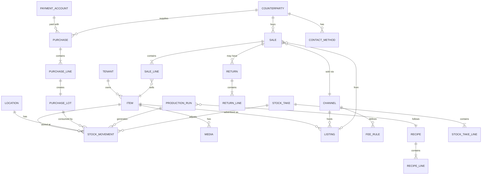
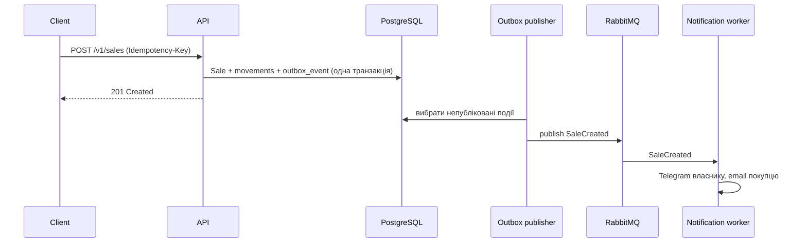

# Lotbook — генеральний план

> Lotbook: навчальний проект і реальний інструмент обліку. NestJS + React Native (Expo) + PostgreSQL + Redis + RabbitMQ.
> Стартова версія: безкоштовні й локальні сервіси. Довгострокова перспектива: SaaS для інших дрібних бізнесів.

## Зміст

1. [Мета та контекст](#1-мета-та-контекст)
2. [Скоуп: MVP, пізніше, не робимо](#2-скоуп)
3. [Ключові доменні рішення](#3-ключові-доменні-рішення)
4. [Модель даних](#4-модель-даних)
5. [Архітектура](#5-архітектура)
6. [Подієва схема (RabbitMQ + Outbox)](#6-подієва-схема)
7. [Калькулятор ціни](#7-калькулятор-ціни)
8. [Інвентаризація](#8-інвентаризація)
9. [Мобільний клієнт](#9-мобільний-клієнт)
10. [Нотифікації, магазин, оплата, друк](#10-нотифікації-магазин-оплата-друк)
11. [Спостережуваність](#11-спостережуваність)
12. [Безпека та мультитенантність](#12-безпека-та-мультитенантність)
13. [Структура монорепо](#13-структура-монорепо)
14. [Етапи й backlog](#14-етапи-й-backlog)
15. [Ризики](#15-ризики)
16. [ADR: рішення, які треба зафіксувати](#16-adr)
17. [Відкриті питання](#17-відкриті-питання)

---

## 1. Мета та контекст

**Критерій успіху проекту:** система розгорнута, нею можна користуватись щодня, і її можна показати на співбесіді як завершену реалізацію.

**Задача:** облік товарів і послуг для невеликого бізнесу: перепродаж з AliExpress, власні вироби (3D-друк), компоненти й витратники. Продажі на OLX, Монобазарі та інших майданчиках.

**Навчальні цілі:**

- проєктування домену й архітектури бекенду (модульний моноліт, DDD-lite, події);
- PostgreSQL, транзакції, конкурентність;
- RabbitMQ і Redis на практиці, а не «з коробки»;
- Docker/Compose, конфігурація, деплой, самостійно написані yml;
- спостережуваність: логи, метрики, трейси;
- React Native / Expo з офлайн-режимом;
- production-практики: тести, CI, безпека, міграції.

**Реальність масштабу:** склад 100–200 найменувань, один користувач, обороти хобі-рівня. Навантаження тривіальне. Усі «важкі» технології (черги, кеш, моніторинг) використовуються **для навчання**, а не через потребу. Це варто пам'ятати й не вигадувати для них штучних обґрунтувань.

## 2. Скоуп

### MVP (етапи 1–4)

- Каталог: товари, послуги, фото, локації.
- Закупівлі: партії з кількох рядків, спільні витрати, валюти, картки.
- Журнал рухів складу (ledger), залишки, списання, втрати, пошкодження.
- Виробництво: збірка виробів із компонентів.
- Продажі: канали, комісії, повернення.
- Калькулятор ціни.
- Мобільне введення: фото + чернетка, дозаповнення пізніше.

### Пізніше (етапи 5–9)

- Інвентаризація, звіти, друкарські шаблони.
- Події, нотифікації (Telegram, email).
- Спостережуваність.
- Міні-магазин із замовленнями й ручною оплатою.
- Онлайн-оплата, SaaS-готовність.
- Опційно: веб-адмінка на Angular.

### Не робимо (поки)

- Податковий облік і фіскальні документи (не ФОП).
- Серійні номери, терміни придатності.
- Білінг/плани підписки.
- Автоматичне розміщення оголошень на майданчиках.
- Генерація QR (закласти лише поле `short_code`).

## 3. Ключові доменні рішення

### 3.1. Склад як журнал рухів

Залишок не зберігається як змінюване поле. Він **обчислюється** з `StockMovement`. Це дає історію, аудит і прості звіти.

| Тип руху | Опис |
|---|---|
| `PURCHASE_IN` | надходження з партії закупівлі |
| `SALE_OUT` | продаж |
| `RETURN_IN` | повернення від покупця назад на склад |
| `PRODUCTION_CONSUME` | споживання компонента у збірці |
| `PRODUCTION_OUTPUT` | випуск готового виробу |
| `WRITE_OFF` | списання |
| `LOSS` | втрата |
| `DAMAGE` | пошкодження |
| `TRANSFER_OUT` / `TRANSFER_IN` | переміщення між локаціями |
| `STOCKTAKE_ADJUST` | коригування за результатами інвентаризації |

Правила:

- Рух незмінний (append-only). Помилку виправляє компенсуючий рух.
- Кожен рух має: `item_id`, `lot_id`, `location_id`, `quantity` (зі знаком), `reason`, `ref_type` + `ref_id` (документ-джерело), `occurred_at`, `created_by`.
- Залишок = сума `quantity` по `item_id` (+ `lot_id` / `location_id` за потреби).
- Для продуктивності можна тримати кеш-таблицю залишків, яка оновлюється в тій самій транзакції. Але джерело істини — ledger.

**Резервування** (передзамовлення, незакриті замовлення) — окрема таблиця `Reservation`. Вона не змінює фізичний залишок: `доступно = на складі − зарезервовано`.

**Від'ємний залишок:** дозволений прапорцем із попередженням «потребує розбору». Продаж без наявності може бути ситуативною реальністю, тому система не блокує, а сигналізує.

### 3.2. Партії закупівлі та собівартість

- `Purchase` (документ) → кілька `PurchaseLine` → кожна породжує `PurchaseLot`.
- Спільні витрати закупівлі (доставка, мито, знижка) розподіляються на рядки пропорційно вартості:

```
частка_рядка = вартість_рядка / сума_вартостей_рядків
додаткова_вартість_рядка = частка_рядка × спільні_витрати
повна_собівартість_одиниці = (вартість_рядка + додаткова_вартість_рядка) / кількість
```

- Метод списання: **FIFO по партіях** (кожен рух посилається на `lot_id`). Для штучних речей партія зазвичай містить одну одиницю, тому це дає точну собівартість. Остаточне рішення фіксується в ADR-001.

### 3.3. Гроші та валюти

- Суми зберігаються як **цілі числа в мінімальних одиницях** (копійки, центи) разом із кодом валюти. Ніколи `float`.
- Базова валюта: **UAH**. Підтримувані: UAH, USD, EUR.
- Для кожної операції закупівлі зберігається:
  - `amount` + `currency` (оригінал);
  - `fx_rate` (курс НБУ на дату) + `fx_source`;
  - `amount_base` (сума в UAH, обчислена);
  - `amount_base_actual` (опційно, вручну: фактично списано з картки, бо курс картки відрізняється від НБУ).
- Собівартість у UAH фіксується **на день покупки**.
- Продажі зазвичай у UAH, курс на день продажу зберігається лише якщо продаж в іншій валюті.
- Калькулятор має окремий режим «вартість поповнення за поточним курсом» (див. розділ 7).
- Джерело курсів: API НБУ (безкоштовне). Таблиця `ExchangeRate` з кешем за датою; воркер щодня підтягує курси.
- Платіжні рахунки (картки): `PaymentAccount` з назвою й валютою; без зберігання номерів карток.

### 3.4. Два типи позицій

- **Штучні (unique):** одна позиція = одна одиниця; власні фото, ціна, статус. Типово — перепродаж.
- **Кількісні (stock):** компоненти й витратники з одиницею виміру (шт, г, м). Мають залишок, партії, локації.

### 3.5. Статуси штучної речі

```
draft → in_stock → listed → reserved → sold → shipped
                                       ↘ returned → in_stock | damaged | written_off
Термінальні: consumed, lost, damaged, written_off
```

Переходи **не жорсткі**: допускаються довільні переходи, система перевіряє лише інваріанти складу й видає попередження.

### 3.6. Виробництво (збірка)

- `Recipe` (BOM): які компоненти й у якій кількості потрібні на одиницю виробу. Це шаблон.
- `ProductionRun`: фактична збірка. Може відхилятися від рецепта (реальне споживання).
- Результат: рухи `PRODUCTION_CONSUME` для компонентів і `PRODUCTION_OUTPUT` для виробу.
- Собівартість виробу = сума собівартості спожитих лотів + опційно накладна ставка.

### 3.7. Послуги (друк на замовлення)

`Service` — нескладська позиція з компонентами вартості:

- споживані матеріали (грами філаменту);
- час машини × ставка (електрика + знос);
- час моделювання;
- пакування.

Замовлення послуги може запускати `ProductionRun`, що списує матеріали зі складу.

### 3.8. Повернення

`Return` прив'язане до `Sale`:

- причина, сума повернення коштів, витрати на зворотну доставку;
- результат по кожному рядку: `restock` / `damaged` / `write_off`;
- результат генерує відповідний рух (`RETURN_IN`, `DAMAGE` тощо).

### 3.9. Пакування

`PackagingProfile` на товар (коробка, плівка, наліпка): споживається автоматично під час продажу й входить у маржу. Доставка, яку платить клієнт, фіксується інформаційно (трекінг, перевізник).

### 3.10. Локації

`Location` — дерево (кімната → стелаж → полиця → коробка). Залишок по локаціях рахується з рухів, переміщення — окремі рухи. Поле `short_code` закладене під майбутні QR.

### 3.11. Загальні витрати

`Expense`: електрика, інструменти, реклама, підписки, амортизація обладнання. У калькуляторі використовується **накладна ставка**, яку задає власник («грн за годину друку» або «% до собівартості»). Автоматичний розподіл усіх витрат по товарах — пізніше.

### 3.12. Контрагенти, контакти та посилання

- `Counterparty`: одна таблиця для постачальників і клієнтів (теги ролі, назва, нотатки). Усі поля, крім назви, необов'язкові.
- `ContactMethod`: тип (телефон, email, Telegram, URL профілю, інше), значення, мітка. Гнучко покриває «контакти чи посилання».
- `PurchaseLine.product_url`: де куплено (наприклад, сторінка на AliExpress).
- `Listing`: оголошення товару на майданчику (канал, URL, зовнішній ID, виставлена ціна, дати, статус). Один товар може мати кілька оголошень і передоголошення.
- `Sale.listing_id` і `Sale.counterparty_id` необов'язкові; для маркетплейсів є вільне поле «нік покупця».
- Персональні дані клієнтів: зберігати мінімум; доступ за ролями; у майбутньому SaaS потрібні експорт і видалення за запитом.

### 3.13. Ролі й права

- RBAC із **permissions** (`sales:create`, `cost:read`); ролі це набори permissions, оголошені в коді. `Membership` пов'язує користувача, тенанта й роль.
- Стартові ролі: `owner`, `manager`, `warehouse`; за потреби `viewer`. Кастомні ролі: пізніше.
- Права перевіряє сервер (guard + `@RequirePermission`); мобільний лише ховає елементи інтерфейсу.
- Чутливі поля (закупівельна ціна, маржа) приховуються через різні response-схеми залежно від прав.
- Механізм permissions закладається рано (етап 2), повна матриця й тести прав на етапі 9.

## 4. Модель даних

### Перелік сутностей (v1)

| Група | Сутності |
|---|---|
| Каталог | `Item`, `ItemVariant` (за потреби), `Service`, `Recipe`, `RecipeLine`, `PackagingProfile`, `Media` |
| Склад | `Location`, `StockMovement`, `Reservation`, `StockTake`, `StockTakeLine` |
| Закупівлі | `Purchase`, `PurchaseLine`, `PurchaseLot`, `Counterparty`, `ContactMethod`, `PaymentAccount`, `ExchangeRate` |
| Виробництво | `ProductionRun`, `ProductionRunLine` |
| Продажі | `Channel`, `FeeRule`, `Sale`, `SaleLine`, `Listing`, `Return`, `ReturnLine` |
| Фінанси | `Expense`, `ExpenseCategory` |
| Платформа | `Tenant`, `User`, `Membership`, `OutboxEvent`, `AuditLog`, `NotificationTemplate`, `DeliveryLog` |

Усі таблиці мають `tenant_id`. Ідентифікатори — UUID (бажано v7 для впорядкованості). Усі суми — `bigint` + `currency`.

### ER-діаграма (спрощена)



## 5. Архітектура

### 5.1. Загальна схема

- **Модульний моноліт** на NestJS. Мікросервіси не потрібні.
- Два процеси з одного кодобейсу:
  - `api` — HTTP API;
  - `worker` — консьюмери RabbitMQ (NestJS standalone application context).
- Клієнти: Expo (мобільний), опційно Angular (веб-адмінка), публічна вітрина магазину.
- API-контракт: **REST + OpenAPI**, версіонування `/v1`, cursor-пагінація, єдиний формат помилок (`application/problem+json`), `Idempotency-Key` на POST для продажів і платежів.
- Клієнти генеруються з OpenAPI (наприклад, openapi-typescript / orval); спільні zod-схеми лежать у `packages/contracts`.

### 5.2. Модулі бекенду

| Модуль | Відповідальність |
|---|---|
| `auth` | автентифікація, соцлогіни, сесії/токени, ролі |
| `tenancy` | тенанти, членство, контекст запиту |
| `catalog` | товари, послуги, рецепти, пакування |
| `media` | фото, presigned-завантаження, мініатюри |
| `inventory` | ledger, залишки, локації, резерви |
| `purchasing` | закупівлі, партії, розподіл витрат, валюти |
| `fx` | курси НБУ |
| `production` | збірки, BOM |
| `sales` | продажі, канали, комісії, повернення |
| `pricing` | калькулятор ціни (чиста доменна логіка) |
| `stocktake` | інвентаризація |
| `expenses` | загальні витрати |
| `reporting` | звіти й агрегації |
| `notifications` | Telegram, email, шаблони, журнал доставки |
| `documents` | друкарські шаблони, PDF |
| `storefront` | публічний каталог, замовлення (етап 8) |
| `payments` | інтерфейс провайдера, станова машина платежу (етап 8–9) |
| `platform` | outbox, аудит, health, метрики |

Правила залежностей: модулі спілкуються через публічні сервіси/події, а не через чужі таблиці. Доменна логіка (`pricing`, ledger-інваріанти) — чисті функції без залежності від NestJS і ORM, покриті юніт-тестами.

### 5.3. Стек

| Шар | Технологія | Примітка |
|---|---|---|
| Бекенд | NestJS (TypeScript) | модульний моноліт |
| БД | PostgreSQL + Prisma | міграції в репо |
| Кеш, локи | Redis | кеш, rate limit, ідемпотентність, короткі токени |
| Черга/події | RabbitMQ | задачі й доменні події; BullMQ не використовуємо |
| Файли | MinIO (S3-сумісний) | у проді R2/S3 без зміни коду |
| Мобільний | Expo, expo-router | камера, expo-sqlite, image-manipulator |
| Мобільний стан | TanStack Query, Zustand, react-hook-form + zod | |
| Авторизація | Better Auth або Passport (рішення після spike) | див. розділ 12 |
| Email | nodemailer + Mailpit (локально) | у проді Resend/SES |
| Telegram | grammY або nestjs-telegraf | |
| PDF | HTML + CSS (`@page`) → Playwright/pdfmake | у воркері |
| Шаблони | Handlebars або Eta | версіонування |
| Тести | Jest, supertest, Testcontainers | |
| E2E мобільний | Maestro | опційно |
| CI | GitHub Actions | |
| Інфра | Docker Compose | postgres, redis, rabbitmq, minio, mailpit, api, worker |

> Конкретні бібліотеки (auth, платежі, Telegram) вибирай після короткого spike (1–2 дні). Інтерфейси (`PaymentProvider`, `NotificationChannel`) проектуй до вибору бібліотек.

### 5.4. CQRS-lite (ADR-0013)

- Команди (`RegisterPurchase`, `RegisterSale`, `CreateReturn`, `CloseStockTake`, `RunProduction`) змінюють стан; запити (залишки, звіти, прибуток) лише читають.
- Структура модуля: `commands/`, `queries/`, `domain/`, `infrastructure/`. Обробники це звичайні класи use-case; `@nestjs/cqrs` не обов'язковий.
- Застосовується вибірково: `inventory`, `purchasing`, `sales`, `stocktake`. Каталог і довідники лишаються простим CRUD.
- Доменні події йдуть тільки через outbox у RabbitMQ; in-process EventBus не використовується.
- Read-моделі: спочатку SQL-запити й подання (етап 5), потім за бажанням проєкція через консьюмер (етап 6).
- Повний Event Sourcing не використовується: ledger append-only, цього достатньо.

## 6. Подієва схема

**Ролі брокера й кешу:**

- RabbitMQ: доменні події й фонові задачі (нотифікації, PDF, мініатюри, звіти, курси валют).
- Redis: кеш, rate limiting, локи, одноразові коди. Не використовується як черга.

**Outbox pattern:**

1. Модуль у **тій самій транзакції** змінює дані й пише подію в `outbox_event`.
2. Publisher (у воркері) читає непублікованих і публікує в RabbitMQ, помічає як відправлені.
3. Консьюмери обробляють подію: **ідемпотентно** (таблиця `processed_event` або природний ключ), з retry та dead-letter queue.



**Приклади подій:** `PurchaseRegistered`, `SaleCreated`, `ReturnCreated`, `StockLow`, `StockTakeClosed`, `OrderPlaced`, `PaymentConfirmed`, `DocumentRequested`, `MediaUploaded`.

**Топологія:** topic exchange `domain.events`, окремі черги на консьюмера (`notifications`, `documents`, `media`, `reporting`), DLX + черга `*.dlq`, retry з експоненційною затримкою.

## 7. Калькулятор ціни

Чиста функція в модулі `pricing`. Ціна рахується **зворотною формулою**, бо комісія залежить від самої ціни:

```
база = собівартість + пакування + вартість_місця + накладні
ціна = база / (1 − комісія% − податок% − цільова_маржа%)
```

Умова: `комісія% + податок% + маржа% < 100%`.

### Приклад (умовні ставки)

| Складова | Значення |
|---|---|
| Собівартість | 300 грн |
| Пакування | 15 грн |
| Вартість місця | 5 грн |
| Накладні | 10 грн |
| **База** | **330 грн** |
| Комісія | 10% |
| Податок | 0% |
| Цільова маржа | 20% |

```
ціна = 330 / (1 − 0,10 − 0 − 0,20) = 330 / 0,70 ≈ 471,43 грн
```

### Режими

- **За цільовою маржею** (вище).
- **Мінімальна ціна без збитку:** маржа = 0.
- **Зворотний розрахунок:** по заданій ціні показати фактичну маржу й прибуток.
- **Порівняння каналів:** та сама позиція по кожному `Channel` із його `FeeRule`.
- **Собівартість:** за фактом закупівлі або за вартістю поповнення (поточний курс валюти).
- **Вартість місця:** ставка за одиницю об'єму/полиці × очікуваний час на складі (параметри власника).
- Поле `tax%` лишається, значення 0.

### Правила комісій (`FeeRule`)

- Не хардкодимо ставки. Тип: відсоток, фіксована сума, або їх комбінація; діапазон дат дії; канал.
- Актуальні ставки майданчиків перевіряються власником самостійно.
- У кожному продажі зберігається **фактична** комісія.

## 8. Інвентаризація

- `StockTake`: сесія для області (весь склад, локація, категорія).
- `StockTakeLine`: `expected`, `counted`, `difference`, коментар.
- Закриття сесії генерує коригувальні рухи `STOCKTAKE_ADJUST` із причиною.
- Режими підрахунку: повний, вибірковий, «сліпий» (без показу очікуваного).
- Мобільний: список за локацією, швидке введення кількості, сканування QR (коли з'явиться).
- Друкований чекліст (PDF) на сесію.
- Звіт ABC-аналізу (які позиції рухаються найчастіше) — основа для оптимізації розташування.

## 9. Мобільний клієнт

**Сценарій:** фото товару (1..N) → мінімум полів → чернетка → дозаповнення пізніше.

- Клієнтський UUID (v7) на чернетці: дозволяє створювати записи офлайн і синхронізувати **ідемпотентно**.
- Локальна БД `expo-sqlite`, черга синхронізації (outbox на пристрої), retry, видимі статуси «не синхронізовано».
- Фото: стиснення на пристрої → presigned PUT у MinIO → підтвердження → мініатюри у воркері.
- Навігація: expo-router; форми: react-hook-form + zod зі схемами з `packages/contracts`.
- Авторизація: OAuth з PKCE (`expo-auth-session`). На iOS, якщо є соцлогіни, потрібен також Sign in with Apple.
- Помилки: Sentry для React Native.
- Розповсюдження: Android APK / EAS; iOS — за потреби (TestFlight).

## 10. Нотифікації, магазин, оплата, друк

### 10.1. Нотифікації

Модуль `notifications` з абстракцією каналу `NotificationChannel` (Telegram, Email, пізніше push).

- **Telegram:** бот, прив'язка чату через deep link `/start <одноразовий токен>`.
- **Email:** nodemailer; локально Mailpit; шаблони MJML або react-email; у проді Resend/SES.
- `DeliveryLog`: статус, спроби, помилка. Налаштування користувача: які події в який канал.
- Шаблони версіонуються, мови: UA (і-18n закласти).

### 10.2. Міні-магазин (етап 8)

- Окремий bounded context `storefront`, читає публічний read-model каталогу.
- Замовлення → резервування (`Reservation`) → нотифікація власнику в Telegram.
- Оплата спочатку **ручна**: власник підтверджує вручну.

### 10.3. Оплата (етапи 8–9)

- Інтерфейс `PaymentProvider`; реалізації: `ManualPayment` (старт) і онлайн-провайдер (пізніше).
- Станова машина платежу: `pending → paid → failed | refunded`.
- Вебхуки: перевірка підпису, ідемпотентність, журнал.
- Для України розглянути Monobank acquiring, LiqPay, WayForPay; доступність і умови перевірити окремо.

### 10.4. Друкарські шаблони

Підхід: HTML + CSS (`@page`) + шаблонізатор → PDF.

| Документ | Формат |
|---|---|
| Внутрішня квитанція/чек | термо 58/80 мм |
| Чекліст інвентаризації | A4 |
| Звіти (залишки, продажі, втрати) | A4 |
| Етикетки локацій і товарів | мала етикетка, QR (пізніше) |

- Рендер у воркері через RabbitMQ-задачу `DocumentRequested`.
- Результат у MinIO; посилання з терміном дії.
- Шаблони версіонуються; тестується snapshot-ом HTML.

## 11. Спостережуваність

Усе локально в Docker Compose. Починай із мінімуму, решту додай пізніше.

| Сигнал | Інструмент | Примітка |
|---|---|---|
| Логи | pino (JSON) | correlation-id через `nestjs-cls` (AsyncLocalStorage), передається у повідомлення RabbitMQ |
| Метрики | `prom-client` → Prometheus → Grafana | + бізнес-метрики: продажі, помилки платежів, довжина черг |
| Трейси | OpenTelemetry → Tempo або Jaeger | шлях запиту API → RabbitMQ → консьюмер |
| Агрегація логів | Loki + Grafana | другий пріоритет |
| Помилки | Sentry (free) або GlitchTip | API, worker, мобільний |
| Health | `@nestjs/terminus` | liveness / readiness |
| Інфра-UI | RabbitMQ Management, RedisInsight | |
| Аудит | таблиця `audit_log` | окремо від технічних логів: хто й що змінив |

**Порядок:** pino + Prometheus + Grafana → Sentry → OpenTelemetry → Loki/Tempo.

## 12. Безпека та мультитенантність

**Автентифікація:**

- Готова бібліотека + соцлогіни (Google та ін.), верифікація email.
- Кандидати: **Better Auth** (TypeScript, соцпровайдери, плагін організацій) або **Passport.js**. Актуальність інтеграції з NestJS перевірити в spike.
- Паролі: argon2. Токени: короткий access + refresh з ротацією. Rate limiting на логін (Redis).

**Авторизація:** RBAC із permissions, ролі `owner`, `manager`, `warehouse` (опційно `viewer`); guard + `@RequirePermission`; перевірка належності до тенанта; приховування чутливих полів (див. 3.13).

**Мультитенантність:**

- `tenant_id` у всіх таблицях; фільтрація в одному місці (Prisma extension / guard).
- Опційно Row-Level Security у PostgreSQL як друга лінія захисту.
- Тести на ізоляцію: користувач A не бачить дані B (обов'язково перед SaaS).

**Загальне:**

- Валідація вхідних даних скрізь (zod / class-validator).
- Секрети тільки з env, не в репо.
- Резервні копії БД (pg_dump за розкладом) і перевірка відновлення.
- Presigned URL з обмеженим терміном і типом файлу.

## 13. Структура монорепо

```
inventory/
├─ apps/
│  ├─ api/            # NestJS HTTP API
│  ├─ worker/         # NestJS standalone: консьюмери RabbitMQ
│  ├─ mobile/         # Expo (React Native)
│  └─ admin-web/      # Angular (опційно, пізніше)
├─ packages/
│  ├─ contracts/      # zod-схеми, типи, згенерований API-клієнт
│  ├─ domain/         # чисті доменні функції (pricing, cost allocation)
│  └─ config/         # eslint, tsconfig, prettier
├─ infra/
│  ├─ docker-compose.yml
│  ├─ docker-compose.observability.yml
│  └─ grafana/, prometheus/
├─ docs/
│  ├─ adr/            # architecture decision records
│  ├─ domain.md       # глосарій, event storming
│  └─ runbook.md
└─ .github/workflows/
```

Інструменти: pnpm workspaces + Turborepo; Conventional Commits; PR-флоу зі squash-merge і захистом гілки.

## 14. Етапи й backlog

Кожен етап завершується: працююча фіча, тести ключової логіки, оновлені ADR та README.

### Етап 0. Домен (≈ 1 тиждень, без коду)

- Event storming на папері, глосарій, ER-діаграма.
- ADR-001…005 (див. розділ 16).
- Результат: затверджена модель даних і список use-case.

### Етап 1. Ядро API

- Каркас монорепо, Docker Compose (postgres), міграції, конфіг.
- Модулі `catalog`, `purchasing`, `inventory`: ledger, партії, розподіл витрат, залишки.
- Структура модулів `commands/`, `queries/`, `domain/`, `infrastructure/` (CQRS-lite, ADR-0013); контрагенти й контакти.
- Валідація, єдиний формат помилок, пагінація, OpenAPI.
- **Інтеграційні тести ledger** (конкурентні списання).

*Навчання:* архітектура модулів, транзакції Prisma, ізоляція транзакцій, конкурентність.
*DoD:* закупівля → залишок обчислюється правильно; два паралельні списання не дають некоректного залишку.

### Етап 2. Мобільне введення

- Expo: чернетка товару з фото, дозаповнення, список, пошук.
- Media: presigned-завантаження в MinIO, мініатюри (поки синхронно).
- Офлайн-чернетки, синхронізація з ідемпотентністю.
- Auth: базова автентифікація (spike вибору бібліотеки).
- Каркас permissions: guard + `@RequirePermission` (ADR-0014), поки одна роль `owner`.

*Навчання:* RN/Expo, офлайн-синхронізація, робота зі S3-сумісним сховищем.
*DoD:* товар створюється офлайн і з'являється на сервері після з'єднання без дублікатів.

### Етап 3. Продажі й комісії

- `Channel` + `FeeRule`, `Sale`, `SaleLine`, фактична комісія, пакування.
- Повернення, списання, втрати, пошкодження.
- `ProductionRun` + `Recipe`.
- Курси НБУ, валюти, картки.
- Клієнти (`Counterparty`), `Listing`, посилання на товар у закупівлі.

*DoD:* прибуток по продажу правильно рахується з урахуванням собівартості, пакування, комісії; повернення коректно змінює склад.

### Етап 4. Калькулятор ціни

- Доменна функція в `packages/domain`, юніт-тести (таблиця кейсів, граничні умови).
- API та UI в мобільному: розбивка й порівняння каналів.
- Режим вартості поповнення за поточним курсом.

*DoD:* усі режими покриті тестами; сума складових збігається з ціною.

> **Кінець MVP.** Далі — тільки після реального використання MVP.

### Етап 5. Інвентаризація, звіти, друк

- `StockTake`, коригувальні рухи, ABC-аналіз.
- Звіти: залишки, оборот, прибуток по каналах, втрати, dead stock.
- Read-моделі: SQL-запити й подання для звітів.
- Друкарські шаблони (чекліст, звіт, квитанція), PDF у воркері.
- Локації: дерево, переміщення.

### Етап 6. Події й нотифікації

- Outbox, RabbitMQ (exchange, черги, DLQ, retry), воркер.
- Telegram (прив'язка чату) і email (Mailpit локально).
- `DeliveryLog`, налаштування, шаблони.
- Redis: кеш, rate limit, ідемпотентність.
- Опційно: проєкція залишків або звіту через консьюмер (eventual consistency).

*Навчання:* асинхронна архітектура, ідемпотентні консьюмери, обробка збоїв.
*DoD:* подія `SaleCreated` гарантовано доходить до нотифікації навіть при перезапуску воркера.

### Етап 7. Спостережуваність

- pino + correlation-id, Prometheus + Grafana, Sentry, health-checks.
- OpenTelemetry-трейси через API → RabbitMQ → worker.
- Дашборд Grafana (запити, помилки, черги, бізнес-метрики).

*DoD:* можна по correlation-id відстежити проблемний запит наскрізь.

### Етап 8. Міні-магазин

- Публічний каталог, замовлення, резервування.
- Telegram-нотифікації власнику, email покупцю.
- Ручна оплата через `PaymentProvider`.

### Етап 9. Production-готовність і SaaS

- Docker multi-stage, самостійно написані compose/yml, деплой на VPS або безкоштовний хостинг.
- Backup/restore, rate limiting, hardening.
- Тести ізоляції тенантів, матриця ролей і тести прав, приховування чутливих полів, CSV імпорт/експорт.
- Онлайн-оплата (за потреби), документація API.
- Опційно: Angular веб-адмінка.

## 15. Ризики

| Ризик | Що робити |
|---|---|
| **Обсяг.** Проект на місяці, ризик недобудови | Жорстко зафіксувати MVP (етапи 1–4); решта — після реального використання |
| **Навчальна цінність нівелюється, якщо ядро генерує агент** | Ядро (ledger, калькулятор, інвентаризацію, outbox) писати власноруч; AI — для рев'ю та рутини (DTO, boilerplate) |
| **Дублювання з іншим бекенд-проектом** | Вирішено: Lotbook замінює TaskFlow (та сама навчальна ціль, TaskFlow не розпочато) |
| **Технології заради технологій** | Кожен елемент додавати на своєму етапі й обґрунтувати реальною задачею |
| **Передчасне SaaS** | Закласти `tenant_id` і ізоляцію; білінг і онбординг не будувати без користувачів |
| **Важкий стек на ноутбуці** | Observability-стек вмикати окремим compose-файлом, поетапно |
| **Помилки в грошах і курсах** | Цілі числа, тести на округлення й розподіл витрат, окреме поле фактичної суми |

## 16. ADR

Рішення, які потрібно записати до або під час етапу 0–1:

| # | Рішення | Варіанти / нотатки |
|---|---|---|
| 001 | Метод оцінки запасів | FIFO по партіях (рекомендовано) / середня |
| 002 | Зберігання грошей | цілі в мінімальних одиницях + валюта; правила округлення |
| 003 | Модель мультитенантності | `tenant_id` у спільній схемі + опційно RLS |
| 004 | Ledger | append-only; компенсуючі рухи; кеш залишків чи ні |
| 005 | Ідентифікатори | UUID v7, генерація на клієнті для чернеток |
| 006 | Брокер і кеш | RabbitMQ для подій і задач, Redis для кешу й локів |
| 007 | Outbox | підхід до publisher і ідемпотентності консьюмерів |
| 008 | Авторизація | Better Auth vs Passport (після spike) |
| 009 | Формат документів | HTML → PDF інструмент (Playwright vs pdfmake) |
| 010 | Контракт API | OpenAPI-first чи code-first + генерація клієнтів |
| 011 | Від'ємний залишок | дозволено з попередженням |
| 012 | Стратегія деплою | де і як хоститься продакшн |
| 013 | Межі CQRS | CQRS-lite у ledger/purchasing/sales/stocktake; без Event Sourcing |
| 014 | Модель RBAC | permissions у коді, ролі owner/manager/warehouse, приховування чутливих полів |

## 17. Відкриті питання

- Курс валюти: зберігати на день закупівлі (рекомендовано) і за потреби на день продажу; підтвердити, чи потрібен курс продажу.
- Чи знадобиться пізніше фіскальний облік, якщо оборот зросте або з'явиться ФОП?
- Які саме канали продажу й правила комісій заводити першими (OLX, Монобазар, інші)?
- Чи потрібна веб-адмінка (Angular) вже в MVP, чи достатньо мобільного?
- Мобільний лише Android чи ще й iOS?
- Мови інтерфейсу: тільки українська чи закласти i18n одразу?
- Який хостинг для продакшн-версії (VPS, безкоштовні тарифи, домашній сервер)?
- Як організувати фізичні локації: перший варіант структури дерева (кімната/стелаж/полиця/коробка)?

## 18. Угоди проекту

- Назва: **Lotbook**, репозиторій `lotbook` (публічний на старті, за потреби можна зробити приватним).
- Код, ідентифікатори, коментарі в коді, коміти, PR, ADR, README, CLAUDE.md: англійською.
- Внутрішні документи (план, статус, workflow, devlog, stage-файли): українською.
- Робочий процес описано в [`workflow.md`](workflow.md), поточний стан у [`STATUS.md`](STATUS.md).

## 19. Changelog плану

| Дата | Зміна |
|---|---|
| 2026-11-15 | Перша версія плану; проект названо Lotbook; TaskFlow замінено цим проектом; додано критерій успіху |
| 2026-11-15 | Додано CQRS-lite (ADR-0013), ролі й permissions (ADR-0014), контрагенти, контакти, Listing |
